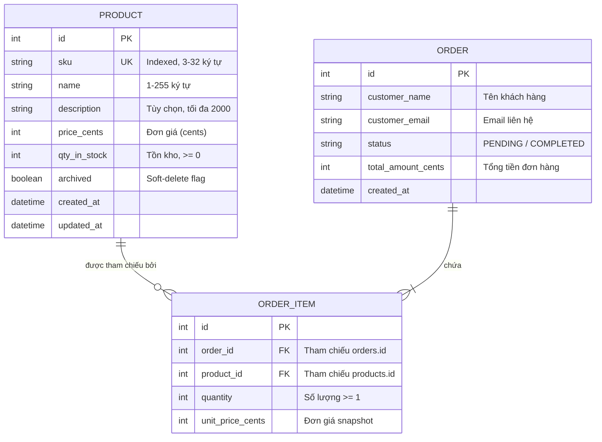

# BÁO CÁO VÀ HƯỚNG DẪN BÀI TẬP VỀ NHÀ - BUỔI 08
## Đề tài: Nguyên lý triển khai Backend Service (Flask, SQLAlchemy 2.x, Marshmallow, Docker)

---

## 1. GIẢI THÍCH CHI TIẾT CÁC YÊU CẦU BÀI TẬP VỀ NHÀ (Slide 40)

Bài tập về nhà buổi 8 đặt ra 5 mục tiêu cốt lõi để xây dựng một dịch vụ Backend chuẩn production:

### 1.1. Yêu cầu 1: Hoàn thiện Lab 1 - Xây dựng Product API CRUD hoàn chỉnh (Slide 22 - 26)
Triển khai đầy đủ 6 endpoints chuẩn RESTful cho tài nguyên `Product`:
1. `GET /api/v1/products`:
   - Hỗ trợ phân trang qua query parameters: `?page=1&size=20`.
   - Cấu trúc response chuẩn: `{"items": [...], "page": 1, "size": 20, "total": N}`.
   - **Bất biến**: Tự động loại trừ các sản phẩm đã bị soft-delete (`archived == True`).
2. `GET /api/v1/products/<int:id>`:
   - Lấy chi tiết 1 sản phẩm.
   - Trả về mã lỗi HTTP `404 Not Found` nếu ID không tồn tại hoặc đã bị soft-delete.
3. `POST /api/v1/products`:
   - Tạo mới sản phẩm với payload JSON được validate qua Marshmallow schema (`sku`, `name`, `price_cents`, `qty_in_stock`, `description`).
   - Xử lý xung đột: Trả về HTTP `409 Conflict` nếu `sku` đã tồn tại trong DB.
4. `POST /api/v1/products/<int:id>/reserve`:
   - Đặt trước / giữ hàng: Body `{"qty": 1}`.
   - Kiểm tra tồn kho: Nếu `qty_in_stock < qty`, trả về HTTP `409 OutOfStock`.
   - Nếu đủ hàng: Trừ trực tiếp số lượng tồn kho `qty_in_stock -= qty` (không để âm).
5. `PATCH /api/v1/products/<int:id>`:
   - Cập nhật một phần dữ liệu (chỉ cập nhật những trường xuất hiện trong request body).
6. `DELETE /api/v1/products/<int:id>`:
   - Thực hiện **soft-delete**: Đánh dấu `archived = True`, không xóa vật lý khỏi DB. Trả về HTTP `204 No Content`.

---

### 1.2. Yêu cầu 2: Thêm Resource `OrderItem` liên kết `Order` và `Product` (/api/v1/orders)
- **Vấn đề cần tránh**: Tránh gán trực tiếp 1 Product duy nhất cho 1 Order (hạn chế mô hình 1-1 nghèo nàn).
- **Mô hình triển khai**:
  - `Order` có quan hệ 1-N với `OrderItem`.
  - Mỗi `OrderItem` liên kết N-1 với `Product`.
  - `OrderItem` lưu trữ snapshot `unit_price_cents` (đơn giá tại thời điểm khách đặt hàng) và `quantity`.
- **Endpoints trên Blueprint `/api/v1/orders`**:
  - `POST /api/v1/orders`: Tạo đơn hàng gồm nhiều mặt hàng. Xử lý atomic trong 1 transaction: kiểm tra từng sản phẩm, kiểm tra tồn kho, trừ tồn kho, tính tổng tiền đơn hàng `total_amount_cents`, lưu `Order` và các `OrderItem`.
  - `GET /api/v1/orders`: Lấy danh sách đơn hàng có phân trang.
  - `GET /api/v1/orders/<int:id>`: Lấy chi tiết 1 đơn hàng kèm đầy đủ danh sách các mặt hàng và thông tin sản phẩm.

---

### 1.3. Yêu cầu 3: Đóng gói bằng Dockerfile + docker-compose
- **Dockerfile (Multi-stage build - Slide 38)**:
  - *Stage 1 (Builder)*: Tạo virtualenv, cài đặt các thư viện phụ thuộc (wheel, psycopg2).
  - *Stage 2 (Runtime)*: Dùng base image siêu nhẹ `python:3.11-slim`, tạo user không có quyền root (`app`), copy virtualenv từ stage 1, chạy Gunicorn WSGI.
- **docker-compose.yml (Slide 39)**:
  - Dịch vụ cơ sở dữ liệu `db`: PostgreSQL 16 Alpine với cơ chế `healthcheck` (`pg_isready`).
  - Dịch vụ ứng dụng `api`: Phụ thuộc vào `db` qua `depends_on: db: condition: service_healthy` giúp API chỉ khởi động khi PostgreSQL đã sẵn sàng kết nối.
  - Chạy trên bất kỳ máy nào mà không cần cấu hình phức tạp: `docker compose up --build`.

---

### 1.4. Yêu cầu 4: Endpoint `/healthz` và `/ready` phân tách (Slide 34 - 35)
- `/healthz` (**Liveness probe**): Trả lời câu hỏi *"Tiến trình còn sống không?"*. Thực thi cực nhanh, không truy vấn cơ sở dữ liệu, trả về HTTP 200 `{"status": "ok"}`.
- `/ready` (**Readiness probe**): Trả lời câu hỏi *"Dịch vụ đã sẵn sàng nhận traffic chưa?"*. Thực hiện kiểm tra phụ thuộc DB bằng câu lệnh `SELECT 1`. Nếu DB kết nối tốt trả về HTTP 200, nếu DB gián đoạn trả về HTTP 503 `{"status": "degraded"}` để orchestrator tạm ngừng điều hướng traffic vào pod.

---

### 1.5. Yêu cầu 5: Kiểm thử tự động với Pytest & Phát hiện bẫy N+1 Query (Slide 18, 19, 40)
- **POST Endpoint Test**: Kiểm tra luồng tạo đơn hàng, tính tiền, trừ kho, và rollback khi hết hàng (mã 409).
- **GET Endpoint Test với Eager Loading**:
  - Khi load quan hệ 1-N lồng nhau (`Order -> OrderItem -> Product`), nếu dùng lazy-load mặc định, hệ thống sẽ phát ra $1 + N + N \times M$ câu truy vấn (bẫy N+1).
  - Sử dụng `selectinload(Order.items).selectinload(OrderItem.product)` để nạp toàn bộ dữ liệu quan hệ chỉ trong **2 - 3 câu truy vấn SQL cố định** (dùng mệnh đề `SELECT ... WHERE order_id IN (...)`).
  - Bộ test sử dụng SQLAlchemy event listener `before_cursor_execute` để khẳng định số câu query phát ra là hằng số.

---

## 2. CẤU TRÚC DỰ ÁN (PROJECT STRUCTURE)

```
api_session_8/
├── config.py              # Cấu hình 12-factor (DefaultConfig, TestConfig, ProductionConfig)
├── extensions.py          # Extension proxy db = SQLAlchemy(), migrate = Migrate()
├── logging_config.py      # Structured JSON logging & request latency logger (Slide 33)
├── errors.py              # ApiError, NotFound, Conflict, OutOfStock, ValidationError & handler
├── models/
│   ├── __init__.py
│   ├── product.py         # Model Product (SQLAlchemy 2.x typed Mapped/mapped_column)
│   └── order.py           # Model Order và OrderItem (Quan hệ 1-N, N-1)
├── schemas/
│   ├── __init__.py
│   ├── product_schema.py  # Marshmallow schemas: ProductIn, ProductOut, ProductPatch, ReserveIn
│   └── order_schema.py    # Marshmallow schemas: OrderIn, OrderOut, OrderItemIn, OrderItemOut
├── routes/
│   ├── __init__.py
│   ├── products.py        # Blueprint /api/v1/products (6 endpoints của Lab 1)
│   ├── orders.py          # Blueprint /api/v1/orders (Tạo và xem đơn hàng với eager loading)
│   └── health.py          # Blueprint /healthz và /ready
├── factory.py             # create_app(config=None) theo Application Factory Pattern
├── app.py                 # Entrypoint chạy trực tiếp phục vụ dev / test nhanh
├── wsgi.py                # WSGI entrypoint cho Gunicorn
├── gunicorn.conf.py       # Cấu hình Gunicorn Production
├── requirements.txt       # Danh sách dependencies
├── .env.example           # File mẫu biến môi trường
├── Dockerfile             # Multi-stage Dockerfile
├── docker-compose.yml     # Compose stack hoàn chỉnh (PostgreSQL + Flask Service)
├── tests/
│   ├── __init__.py
│   ├── conftest.py        # Fixture pytest: in-memory DB, client, query_counter context manager
│   ├── test_products.py   # Test 6 endpoints của Lab 1 (Product CRUD, reserve, soft-delete)
│   └── test_orders.py     # Test POST order & test GET order eager loading chống bẫy N+1
└── README.md              # Báo cáo và tài liệu hướng dẫn
```

---

## 3. SƠ ĐỒ QUAN HỆ THỰC THỂ (ERD)



---

## 4. HƯỚNG DẪN KHỞI CHẠY VÀ KIỂM THỬ

### 4.1. Chạy trực tiếp (Local Development)
1. Kích hoạt môi trường ảo:
   ```powershell
   .\.venv\Scripts\Activate.ps1
   ```
2. Cài đặt dependencies (nếu cần):
   ```bash
   pip install -r requirements.txt
   ```
3. Chạy ứng dụng:
   ```bash
   cd api_session_8
   python app.py
   ```
   Dịch vụ sẽ lắng nghe tại `http://127.0.0.1:5000`.

### 4.2. Chạy với Docker Compose (Chuẩn Production)
Khởi động toàn bộ stack gồm PostgreSQL Database và Flask API:
```bash
cd api_session_8
docker compose up --build
```
Dịch vụ tự động kiểm tra trạng thái sức khỏe của DB trước khi mở cổng API tại `http://localhost:5000`.

### 4.3. Chạy bộ kiểm thử tự động (Pytest)
Để chạy toàn bộ các kịch bản kiểm thử:
```bash
pytest api_session_8/tests -v
```
Bộ test sẽ kiểm tra đầy đủ:
- 6 endpoints của Lab 1 (Product CRUD, reserve, soft-delete, validate schema).
- POST tạo Order (tính tổng tiền, trừ tồn kho, kiểm tra out of stock).
- GET Orders với Eager Loading và khẳng định không bị bẫy N+1 query.
- Liveness và Readiness health probes.

